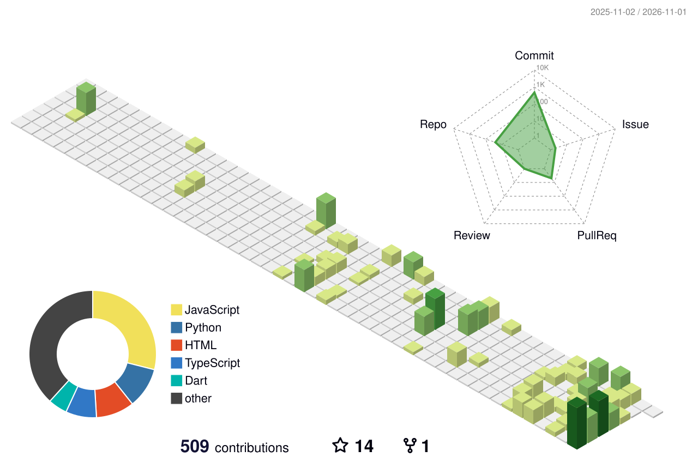

[](https://vexikoff.xyz/)

Visitor counter
[](https://mynickname.com/id1848039)

[](https://vexikoff.xyz/)

## <div>Welcome!</div>
### - Frontend Web and Desktop Apps Developer
### - ~2.5 year exp in web, python
### [](https://skillicons.dev)

---
I exist somewhere between code and creativity.  
I produce music, design in Figma, build for the web, and sculpt in 3D.  
Not a specialist — a creator who refuses to be just one thing.
Against vibecoding. Against AI. Against. AGAINST!
for doing everything on your own.
you didn't write it, the code isn't yours.

---

```
music production  ·  ui/ux design  ·  web development  ·  3d modeling
```

---

### what i'm doing

```bash
> currently: leveling up in c#
> always:    creating something
> status:    somewhere between an idea and a finished project
```

---

<sub>Every expert was once someone who just started.</sub>

<picture>
  <source media="(prefers-color-scheme: dark)" srcset="profile-3d-contrib/profile-night-green.svg">
  <source media="(prefers-color-scheme: light)" srcset="profile-3d-contrib/profile-green-animate.svg">
  
</picture>

<picture>
  <source media="(prefers-color-scheme: dark)" srcset="github-snake-dark.svg">
  <source media="(prefers-color-scheme: light)" srcset="github-snake.svg">
  
</picture>

</div>


<details>
  
  <summary><strong>НЕ ОТКРЫВАТ!!!</strong></summary>

  <br />

  <div>

  #### 

  Я ТЕБЕ ГОВОРИЛ НЕ ОТКРЫВАЙ!
  тут и так нихуя

    
  </div>

</details>


# Top Activity Projects

## 1. [Youhe Bain 1: Others' Circumstances](https://github.com/vexikoff/youhebain1)
You are an ordinary person trying to survive in a world of absurd corporations, persistent scammers, and bizarre phone calls. Your goal is simple: earn points, keep your sanity intact, and stay out of trouble.

When a mysterious hacker named Tolya appears on the scene, you are faced with a choice: remain safe, or enter the world of shadowy scams—where a single mistake could cost you everything.

Genre: Text-based thriller / Survival simulator / Crime drama. Playtime: 45–60 minutes (per playthrough). Number of endings: 5 unique conclusions.

### 2. [Parnasocial](https://github.com/vexikoff/parnasocial)
A Windows desktop media player project in early development.

The goal is a local-first player: no account, no cloud, no telemetry. The current state is an interface prototype. Media playback, folder scanning, playlist management, and full settings are not implemented yet.

### 3. [MicroCut](https://github.com/vexikoff/microcut)
Screenshot hub, coming soon...
